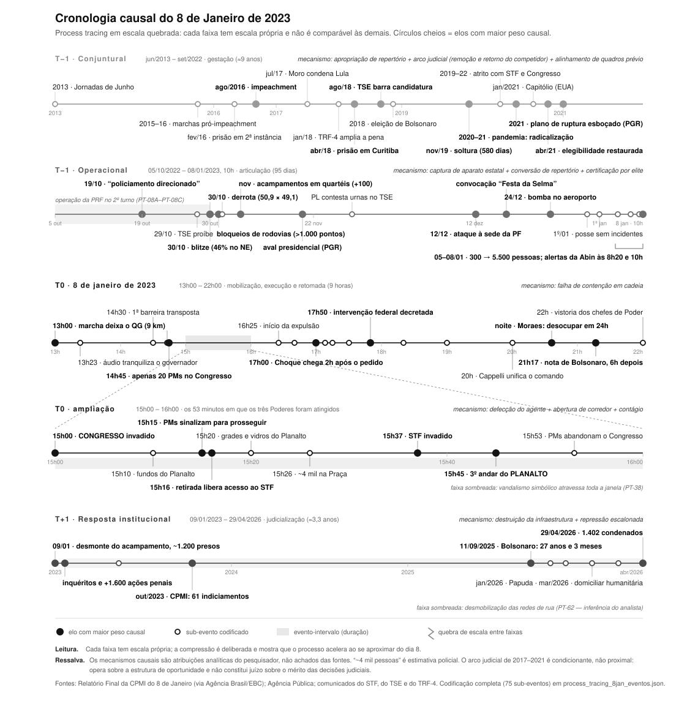

# Camadas de uma ruptura: estruturas de mobilização e oportunidades políticas e discursivas no 8 de Janeiro de 2023

Projeto de pesquisa · Programa Institucional de Pós-Doutorado (PIPD/CAPES)
Programa de Pós-Graduação em Sociologia — IESP/UERJ · Linha: Sociologia Política

---

## 1. Introdução

O 8 de janeiro de 2023 é um dos eventos mais estudados da história recente do país e, ainda assim, não temos dele uma explicação sociológica integrada. A proposição que move esta pesquisa é que as explicações hoje disponíveis não são rivais: são níveis de um mesmo processo, e o que as articula é o par formado pelas oportunidades políticas e discursivas, de um lado, e pelas estruturas de mobilização, de outro.

O diagnóstico não é impressionista. Conduzi e verifiquei item a item um levantamento de 58 títulos, 50 deles confirmados em CrossRef ou em página oficial de periódico,[^1] e ele mostra duas concentrações. A primeira é de fase: 17 títulos tratam do desfecho institucional e apenas 10 da mobilização e da execução. A segunda, mais reveladora, é de base probatória. Das quarenta fichas que declaram método, onze fazem análise de discurso, conteúdo ou enquadramento, oito são jurídico-doutrinárias, seis são ensaísticas, seis histórico-comparativas, três computacionais e duas de entrevista ou grupo focal.[^2] Nenhuma registra a documentação oficial da investigação — relatório da CPMI, relatório da intervenção federal, denúncia da PGR, acórdãos — como base de evidência.

A produção examina sobretudo o que se disse sobre o evento: cobertura, postagens, doutrina, resposta do Supremo. Falta reconstruir como a mobilização foi materialmente montada — acampamento, transporte, dinheiro, convocação —, camada menos coberta na literatura e mais bem documentada nas fontes primárias.

Esta pesquisa parte de onde minha tese parou. Nela (PACCELLI, 2024) analisei três ciclos de protesto no Brasil democrático — 1992, 2013 e 2015 — pela interação entre estruturas de mobilização e oportunidades políticas e discursivas, encerrando com a entrada dos movimentos de direita no repertório de rua; em PACCELLI e PAULA (2026) o mesmo par foi aplicado às juventudes de direita que redescobrem as ruas. O 8 de janeiro é o ponto seguinte desse arco, aquele em que o repertório de protesto se converte em ação antissistêmica violenta.

Pretendemos demonstrar que essas camadas são níveis de um mesmo processo, e que é o par oportunidades e estruturas de mobilização que as articula. A pergunta que a operacionaliza é: como se compõem as camadas estrutural, organizacional, discursiva e situacional para produzir aquele evento, e o que se perde ao explicá-lo por uma só delas?

*Figura 1 — Cronologia causal em escala quebrada. Versão navegável em `figuras/cronologia-interativa.html`.*

---

## 2. Relevância científica

Percorro as quatro camadas na ordem em que operam, dizendo de cada uma o que explica, o que não explica e onde tensiona com a produção existente.

A primeira é a camada estrutural-conjuntural. O ciclo aberto em 2013 introduz um repertório de rua massivo e antipartidário, depois apropriado pela direita (ALONSO, 2017; TATAGIBA; GALVÃO, 2019; GOHN, 2019). A ele se soma o arco judicial de 2016 a 2021, que reconfigurou por via judicial a estrutura de oportunidade eleitoral (RODRIGUES; ARANTES, 2020; MESZAROS, 2020). É literatura que a leitura corrente do 8 de janeiro raramente incorpora — e sem a qual a datação do plano de ruptura em 2021 fica sem antecedente. Falleti e Lynch (2009) dão a isso estatuto metodológico: o mesmo mecanismo produz desfechos distintos em contextos distintos — a camada estrutural não é pano de fundo, é condição de operação das demais.

A segunda é a camada organizacional, simultaneamente a mais vazia na literatura e a mais cheia nas fontes primárias. A Teoria da Mobilização de Recursos ensina que movimentos dependem menos de descontentamento do que de recursos, redes e organizações capazes de convertê-lo em ação (McCARTHY; ZALD, 1977). O caso brasileiro não tem organização formal a que atribuir a mobilização, o que à primeira vista afastaria o modelo. As fontes, porém, registram função organizacional sem organização, e o relatório do interventor federal a enuncia sem rodeios:

> A permanência do acampamento na Praça dos Cristais no Setor Militar Urbano permitiu apoio logístico e local de concentração aos manifestantes que se deslocaram a Brasília para que as ações do dia 08 fossem desencadeadas, sendo verificada, desde o dia 07 de janeiro de 2023, a chegada de vários ônibus vindo de fora de Brasília.[^3]

A passagem estabelece a função e para aí. Um documento escrito para imputar responsabilidade não pergunta o que a sociologia precisa perguntar: quem sustentou aquela infraestrutura, com que recursos e por quanto tempo ela poderia ter durado. O acampamento custou dinheiro, e há contabilidade — captação pulverizada por Pix e nós centralizadores que convertem doação em suprimento; e os comboios vieram de um grupo organizado do agronegócio, com 272 caminhões identificados pela Abin, não de caminhoneiros difusos.[^4] Talvez seja possível, então, estender o modelo de McCarthy e Zald a mobilizações que realizam a função organizacional por outros meios. Almeida (2003) abre precedente: ondas em contextos de fechamento respondem a ameaça, não a abertura, e são organizações herdadas de ciclos anteriores que a convertem em ação. O 8 de janeiro se ergue depois de uma derrota eleitoral, e "oportunidade" descreve mal esse gatilho — tensão com o próprio referencial aqui adotado, que preferimos declarar a contornar.

A terceira é a camada discursiva. Koopmans e Olzak (2004) sustentam que a violência de extrema-direita responde a oportunidades discursivas, isto é, à visibilidade, ressonância e legitimidade que certas afirmações adquirem na esfera pública. O caso alemão difere do brasileiro num ponto decisivo: lá a violência mirava imigrantes, grupo externo à comunidade política; aqui mirou as instituições do Estado. É a mesma mecânica com o alvo deslocado, e o deslocamento não é detalhe — se a oportunidade discursiva legitima o ataque ao próprio Estado, e não a uma minoria, o conceito precisa ser estendido além do objeto para que foi construído. A convocação codificada da "Festa da Selma" e os 185 anúncios pagos localizados na biblioteca do Meta Ads são as formas concretas dessa oportunidade.[^5]

A tensão mais direta com a produção nacional está aqui. A leitura dominante trata a desinformação como causa autônoma; Cammaerts (2012) oferece a alternativa: a mídia não é causa, é estrutura de oportunidade de mediação — terreno em que se disputa quem é noticiado e sob qual designação. Na nuvem de palavras do dia 8, "manifestante" supera "terrorista" e "golpista":[^6] a designação estava em aberto no próprio domingo (CANCI, 2025), o que é disputa em curso, não efeito de mensagem.

A quarta é a camada situacional, onde a explicação depende de sequência fina e não de estrutura: barreiras permeáveis, vinte policiais às 14h45, três alvos ocupados em trinta e sete minutos, duas horas de latência na resposta.

A fonte primária impõe ainda uma correção. O precedente invocado pelos organizadores como "Plano B" não foi o Capitólio, mas a revolta do Sri Lanka de julho de 2022, que seria, nos termos do relatório, "como uma invasão do Capitólio que teria dado certo".[^7] A difusão selecionou o precedente eficaz, e não o culturalmente próximo. Chamar o 8 de janeiro de "Capitólio brasileiro" descreve a forma e erra o cálculo dos atores (KOONINGS; KRUIJT, 2025). Com Motta (2015), a difusão deixa de ser contágio e passa a ser transmissão de cálculo de eficácia em espaço discursivo transnacional — afirmação sobre racionalidade estratégica, não sobre engano, que contraria a literatura que trata esses agentes como crédulos.

Restam as perguntas que nenhuma leitura monocausal responde. Se a oportunidade discursiva legitimou o ataque ao Estado, e não a um grupo externo, o conceito ainda é o mesmo? Se a designação estava em aberto no próprio domingo, o que decidiu a nomeação que se consolidou depois?

Diferenciamo-nos em três pontos. Quanto à base probatória, operamos sobre a documentação oficial da investigação, ausente das quarenta fichas de método. Quanto ao nível de análise, reconstruímos mecanismos de produção do evento, não sentidos atribuídos a ele depois. Quanto à ambição teórica, não acrescentamos uma nona leitura ao conjunto: mostramos como as existentes se encaixam e o que cada uma perde quando opera sozinha.

Cabe, por fim, a pertinência institucional. O projeto se inscreve na linha de Sociologia Política do PPGS, e duas de suas fontes vêm da própria casa: o relatório do Manchetômetro/DOXA-IESP-UERJ e a pesquisa de Feres Junior, De Paula e Mangineli (2026). A camada institucional dialoga com o NECON e com a discussão sobre democracia defensiva (VIEIRA, 2025; AVRITZER; RENNÓ, 2025).

---

## 3. Métodos

A pesquisa adota o *process tracing* como estratégia central, articulado à análise de redes e à recodificação sistemática da literatura. Cinco procedimentos a compõem.

1. Operação sobre base já constituída. A pesquisa opera sobre um banco que construí e auditei: 82 sub-eventos codificados em 16 campos, 60 ancorados em fonte primária com página e transcrição literal arquivada, sobre 20 documentos oficiais que somam 6.819 páginas. A Figura 1 é a visualização desse banco, não ilustração à parte. Partir de base auditada nos permite dedicar o período ao teste dos mecanismos, e não à sua coleta.

2. Testes formais de mecanismo. Os mecanismos hoje registrados são atribuições analíticas, não achados testados. Cada um será submetido aos testes de Beach e Pedersen (2019), cuja lógica de necessidade e suficiência segue Mahoney (2012), com o teste nomeado elo a elo. Adotamos por critério de suficiência a completude do grafo causal (WALDNER, 2015): não há explicação onde reste elo suposto e não observado. Explicações rivais serão tratadas segundo a relação lógica que mantêm com a proposta, na forma sistematizada por Zaks (2017). O elo que não sobreviver ao teste será registrado como refutado, não reescrito para acomodar a evidência: o banco é versionado, e a refutação fica auditável.

3. Leitura integral e recodificação da literatura. As 50 referências confirmadas serão lidas na íntegra e classificadas por camada, por mecanismo afirmado e pelo tipo de evidência que efetivamente apresentam. É o que converte o levantamento de lista em instrumento analítico, e o que sustentará o diagnóstico com leitura, não com contagem de resumos.

4. Análise de redes da arquitetura de recursos. Reconstrução do grafo de financiamento a partir do capítulo sobre financiadores da CPMI e dos relatórios de inteligência financeira nele reproduzidos, tomando por nós doadores, intermediários e fornecedores, e por arestas as transferências documentadas, com medidas de centralidade e identificação dos nós de intermediação. É o instrumento da camada organizacional, e o que permitirá afirmar, ou refutar, a captação pulverizada com nós centralizadores.

5. Protocolo de verificação. Ancoragem de cada afirmação em documento com página; transcrição literal em caderno de evidências; classificação do estatuto de cada registro — fonte primária, confirmação por outra via, dado contextual, inferência declarada; e verificação automatizada de integridade a cada alteração. A regra central responde ao modo de falha que este projeto já identificou quatro vezes, a cifra correta atribuída ao referente errado: conferir todo número contra a fonte, nunca contra outra citação dela.

Dois limites são declarados desde o desenho. O primeiro é de fonte: a evidência sustenta que houve canal pago de circulação e que a moderação falhou, mas não quem pagou — o levantamento de referência não identifica anunciantes nem valores.[^8] O segundo é de desenho, e a literatura metodológica o nomeia como a vulnerabilidade recorrente do campo: trata-se de caso único selecionado pelo desfecho. A inferência pretendida é, por isso, intracaso — não afirmamos que estes mecanismos produzem ruptura em geral, mas que estes elos, nesta sequência, sobreviveram a testes que poderiam tê-los derrubado.

---

## 4. Resultados científicos esperados

Espera-se demonstrar que as quatro camadas são níveis de um mesmo processo e que é o par oportunidades e estruturas de mobilização que as articula — resultado que a produção atual, pela sua concentração de fase e de base probatória, não produziu.

Espera-se ainda a especificação da captação pulverizada com nós centralizadores como modelo de mobilização de recursos sem organização formal, com o grafo que a sustenta; a extensão da oportunidade discursiva a um caso de alvo estatal; a substituição do referente comparativo do Capitólio pelo Sri Lanka; um balanço crítico e por camadas da produção sobre o evento, hoje inexistente; e a publicação auditável de um conjunto de dados de *process tracing* sobre uma tentativa de ruptura democrática.

---

## 5. Produtos esperados

1. Submeter o artigo com a explicação integrada por camadas, resultado central, a *Dados — Revista de Ciências Sociais* ou à *Revista Brasileira de Ciências Sociais*.
2. Submeter o artigo sobre a arquitetura de recursos da mobilização a *Mobilization: An International Quarterly* ou a *Social Movement Studies*.
3. Submeter o balanço crítico da produção sobre o 8 de Janeiro, por camada e tipo de evidência, à *BIB — Revista Brasileira de Informação Bibliográfica em Ciências Sociais*.
4. Depositar o conjunto de dados em repositório aberto, com DOI, codebook, caderno de evidências e scripts de verificação.
5. Ministrar a disciplina cuja ementa e plano de curso acompanham esta candidatura; realizar um seminário de resultados e uma oficina de *process tracing* documental para discentes do PPGS.
6. Apresentar um trabalho por ano nos encontros da SBS e da ANPOCS, e publicar em acesso aberto, como recurso didático, a cronologia interativa já construída.
7. Participar do ensino de graduação e da vida institucional do PPGS, conforme previsto na chamada.

---

## 6. Cronograma

| Semestre | Atividades | Marco |
|:--|:--|:--|
| 1º (meses 1–6) | Integração ao PPGS; leitura e recodificação por camada das 50 referências; testes formais dos mecanismos; oferta da disciplina | Balanço crítico da literatura concluído |
| 2º (meses 7–12) | Redação do artigo 1 (explicação integrada); reconstrução do grafo de financiamento; oficina metodológica | Artigo 1 submetido |
| 3º (meses 13–18) | Análise de redes concluída; redação do artigo 2 (camada organizacional); congresso | Artigo 2 submetido |
| 4º (meses 19–24) | Redação do artigo 3 (balanço crítico); depósito do conjunto de dados; seminário de resultados | Artigo 3 submetido; conjunto de dados com DOI; relatório final |

Cada semestre encerra com marco verificável, e a auditoria de integridade do banco é condição de passagem entre eles.

---

[^1]: Dos 58 títulos: 50 confirmados, 6 não localizados e 2 disponíveis apenas em autoarquivamento. A cifra de 48 registrada na documentação de método exclui os dois de autoarquivamento; adota-se 50, com o critério declarado.

[^2]: Contagem sobre as 40 fichas que declaram método; as 18 restantes não o especificam. Duas operam sobre bases de checagem de fatos.

[^3]: Relatório do Interventor Federal, conclusão A, p. 53.

[^4]: Relatório Final da CPMI, p. 577-578 e 880-884 (captação e nós centralizadores); p. 884-887 (comboios e os 272 caminhões).

[^5]: Relatório Final da CPMI, p. 614-625 (convocação codificada); os 185 anúncios pagos foram localizados pelo NetLab-UFRJ na biblioteca do Meta.

[^6]: Relatório do Manchetômetro/DOXA-IESP-UERJ, p. 9.

[^7]: Relatório Final da CPMI, p. 614.

[^8]: Os relatórios do NetLab e do Manchetômetro não são revisados por pares e entram com essa qualificação; o corpus do Manchetômetro veio de ferramenta descontinuada em 2024, o que impede replicação.

---

## Referências

ALMEIDA, P. D. Opportunity organizations and threat-induced contention: protest waves in authoritarian settings. *American Journal of Sociology*, v. 109, n. 2, p. 345-400, 2003. · ALONSO, A. A política das ruas: protestos em São Paulo de Dilma a Temer. *Novos Estudos CEBRAP*, v. 37, p. 49-58, 2017. · AVRITZER, L.; RENNÓ, L. Conclusion: 2023 and the Difficult Quick Comeback. In: *The Crisis of Democracy in Brazil*. Springer, 2025. · BEACH, D.; PEDERSEN, R. B. *Process-Tracing Methods: Foundations and Guidelines*. 2. ed. University of Michigan Press, 2019. · CAMMAERTS, B. Protest logics and the mediation opportunity structure. *European Journal of Communication*, v. 27, n. 2, p. 117-134, 2012. · CANCI. De manifestantes a terroristas. Dissertação — UNIOESTE, 2025. · FALLETI, T. G.; LYNCH, J. F. Context and causal mechanisms in political analysis. *Comparative Political Studies*, v. 42, n. 9, p. 1143-1166, 2009. · FERES JUNIOR, J.; DE PAULA, C.; MANGINELI, F. O bolsonarismo depois da derrota. *SciELO Preprints*, 2026. · GOHN, M. G. Ciclos de protestos no Brasil: 1970-2019. *Mundos Plurales*, v. 6, n. 1, 2019. · KOONINGS, K.; KRUIJT, D. Coups and Self-Coups in the Americas. Springer, 2025. · KOOPMANS, R.; OLZAK, S. Discursive opportunities and the evolution of right-wing violence in Germany. *American Journal of Sociology*, v. 110, n. 1, p. 198-230, 2004. · MAHONEY, J. The logic of process tracing tests in the social sciences. *Sociological Methods & Research*, v. 41, n. 4, p. 570-597, 2012. · McCARTHY, J. D.; ZALD, M. N. Resource mobilization and social movements. *American Journal of Sociology*, v. 82, n. 6, p. 1212-1241, 1977. · MESZAROS, G. Caught in an authoritarian trap of its own making? *Journal of Law and Society*, 2020. · MOTTA, Renata. Transnational discursive opportunities and social movement risk frames opposing GMOs. *Social Movement Studies*, v. 14, n. 5, p. 576-595, 2015. · MOTTA, Rodrigo Patto Sá. Anticommunism and conspiracy myths in Brazil. Routledge, 2025. · PACCELLI, G. *Estruturas de mobilização e Oportunidades Políticas*. Tese (Doutorado em Ciências Sociais) — UFJF, 2024. · PACCELLI, G.; PAULA, C. J. de. As juventudes de direita redescobrem as ruas. *Revista Agenda Política*, v. 13, n. 2, p. 17-40, 2026. · RODRIGUES, F. A.; ARANTES, R. Supremo Tribunal Federal e a presunção de inocência. *Revista Estudos Institucionais*, v. 6, n. 1, 2020. · TATAGIBA, L.; GALVÃO, A. Os protestos no Brasil em tempos de crise (2011-2016). *Opinião Pública*, v. 25, n. 1, p. 63-96, 2019. · VIEIRA, O. V. Defensive Democracy. In: *Legal Resistance to Autocracy*. Routledge, 2025. · WALDNER, D. Process tracing and qualitative causal inference. *Security Studies*, v. 24, n. 2, p. 239-250, 2015. · ZAKS, S. Relationships among rivals (RAR): a framework for analyzing contending hypotheses in process tracing. *Political Analysis*, v. 25, n. 3, p. 344-362, 2017.

*Aparato bibliográfico completo, por camada e com status de verificação por item, em documento anexo.*
