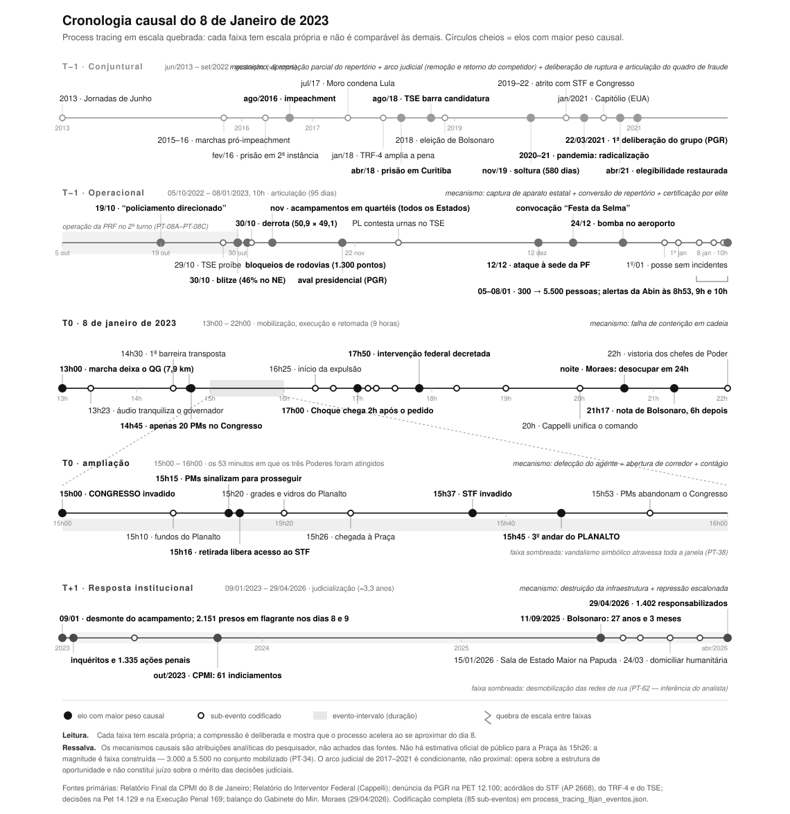

# Camadas de uma ruptura: estruturas de mobilização e oportunidades políticas e discursivas no 8 de Janeiro de 2023

**Projeto de pesquisa · Programa Institucional de Pós-Doutorado (PIPD/CAPES)**
**Programa de Pós-Graduação em Sociologia — IESP/UERJ · Linha: Sociologia Política**

---

## 1. Introdução

O 8 de janeiro de 2023 é hoje um dos eventos mais estudados da história recente do país, e ainda assim não temos dele uma explicação sociológica integrada. Um levantamento bibliográfico que conduzi e verifiquei item a item — 58 títulos, 50 confirmados em CrossRef ou página oficial de periódico — mostra uma produção fragmentada por disciplina. A comunicação explica o evento pela desinformação e pelo enquadramento; o direito, pela tipificação penal e pela resposta do Supremo; a ciência política, pela erosão democrática; a história, pelo mito conspiratório de longa duração (MOTTA, 2025). Cada campo trata a sua camada como suficiente.

A distribuição da produção confirma o diagnóstico. Das 50 referências confirmadas, **17 tratam do desfecho institucional** e apenas **10 da mobilização e execução**; a camada organizacional — como aquela mobilização foi materialmente construída: acampamento, transporte, dinheiro, convocação — é a menos coberta de todas. Explica-se abundantemente o que o Estado fez depois, e muito pouco como aquela multidão chegou à Praça dos Três Poderes.

Esta pesquisa parte de onde minha tese de doutorado parou. Nela (PACCELLI, 2024) analisei três ciclos de protesto no Brasil democrático — a Campanha pela Ética na Política (1992), junho de 2013 e as manifestações de 2015 — pela interação entre **estruturas de mobilização** e **oportunidades políticas e discursivas**, encerrando com a entrada dos movimentos de direita no repertório de rua. O 8 de janeiro é o ponto em que aquele arco chega a um desfecho que o instrumental da tese permite explicar, mas que ela não alcançou: a conversão de um repertório de protesto em ação antissistêmica violenta.

**A pergunta:** como se compõem as camadas estrutural, organizacional, discursiva e situacional para produzir aquele evento — e o que se perde ao explicá-lo por uma só delas?

A Figura 1 apresenta a arquitetura do processo em cinco faixas de escala própria, e é ela que organiza as seções seguintes.

**Figura 1** — Cronologia causal em escala quebrada: cada faixa tem escala própria. Versão navegável em `../reports/figures/cronologia_8jan_interativa.html`.

---

## 2. Relevância científica

**A hipótese de integração.** As explicações disponíveis não são rivais: são níveis de um mesmo processo, e o que as articula é o par que a tese desenvolveu. Oportunidades políticas e discursivas tornam a ruptura *dizível e viável*; estruturas de mobilização a tornam *executável*. Nenhum dos dois termos basta — e é a insistência em usá-los isoladamente que produz a fragmentação diagnosticada acima.

Quatro camadas, com o que cada uma explica e o que não explica:

**Estrutural-conjuntural (faixa T−1 conjuntural).** O ciclo aberto em 2013 introduz um repertório de rua massivo e antipartidário depois apropriado pela direita (ALONSO, 2017; TATAGIBA, 2018; TATAGIBA; GALVÃO, 2019; GOHN, 2019). A ele se soma o arco judicial de 2016–2021, que reconfigurou por via judicial a estrutura de oportunidade eleitoral (RODRIGUES; ARANTES, 2020; MESZAROS, 2020) — literatura que a leitura corrente do 8 de janeiro raramente incorpora, e sem a qual a datação do plano de ruptura em 2021 fica sem antecedente.

**Organizacional (faixa T−1 operacional).** É a camada vazia na literatura e cheia nas fontes primárias. O acampamento não foi manifestação prolongada: foi infraestrutura de mobilização, e o relatório da CPMI o certifica nesses termos. Ele custou dinheiro, e há contabilidade — captação pulverizada por Pix com nós centralizadores que convertem doação em suprimento (CPMI, p. 577-578, 880-884). Os comboios não vieram de "caminhoneiros" difusos, mas de um grupo organizado do agronegócio, com 272 caminhões identificados pela Abin (p. 884-887). É a Teoria da Mobilização de Recursos (McCARTHY; ZALD, 1977) aplicada a um movimento **sem organização formal**, e é a contribuição empírica central do projeto.

**Discursiva (faixa T−1 → T0).** Koopmans e Olzak (2004) mostram que a violência de extrema-direita responde a oportunidades discursivas — à visibilidade, ressonância e legitimidade que certas afirmações adquirem na esfera pública. É o mecanismo que falta às leituras que tratam a desinformação como causa autônoma. A convocação codificada da "Festa da Selma" (CPMI, p. 614-625) e os 185 anúncios pagos localizados na biblioteca do Meta Ads (NetLab-UFRJ) são as formas concretas dessa oportunidade; o *playbook* insurrecional descrito por Bastos e Recuero (2023) é a sua gramática.

**Situacional (faixas T0 e ampliação).** Aqui a explicação depende de sequência fina, não de estrutura: barreiras permeáveis, vinte policiais às 14h45, três alvos ocupados em trinta e sete minutos, duas horas de latência na resposta. E há a disputa pela nomeação do próprio evento — na nuvem de palavras do dia 8, "manifestante" supera "terrorista" e "golpista" (Manchetômetro/DOXA-IESP-UERJ, p. 9): a designação estava em aberto no próprio domingo (CANCI, 2025).

**Uma correção que a fonte primária impõe.** O precedente invocado pelos organizadores como "Plano B" não foi o Capitólio, mas a revolta do Sri Lanka de julho de 2022 — "seria como uma invasão do Capitólio que teria dado certo" (CPMI, p. 614). A difusão transnacional selecionou o precedente **eficaz**, não o culturalmente próximo. Chamar o 8 de janeiro de "Capitólio brasileiro" descreve a forma e erra o cálculo dos atores — ponto ausente da literatura comparada disponível (KOONINGS; KRUIJT, 2025).

**Pertinência institucional.** O projeto se inscreve na linha de Sociologia Política do PPGS, e duas de suas fontes vêm da própria casa: o relatório do Manchetômetro/DOXA-IESP-UERJ e a pesquisa de Feres Junior, De Paula e Mangineli (2026) sobre o bolsonarismo depois da derrota. A camada institucional dialoga com a agenda do NECON e com a discussão sobre democracia defensiva (VIEIRA, 2025; AVRITZER; RENNÓ, 2025).

---

## 3. Métodos

**3.1 Base já constituída.** A pesquisa opera sobre um banco de *process tracing* que construí e auditei: **82 sub-eventos codificados em 16 campos**, 60 deles ancorados em fonte primária com citação por página e transcrição literal arquivada, sobre um corpus de 20 documentos oficiais (6.819 páginas) — Relatório Final da CPMI, relatório do interventor federal, denúncia da PGR, acórdãos do STF e do TSE, e o balanço do STF de abril de 2026. A Figura 1 é a visualização desse banco, e não uma ilustração feita à parte.

**3.2 Process tracing com testes formais.** Os mecanismos hoje registrados no banco são atribuições analíticas, não achados testados. Cada um será submetido aos quatro testes de **Van Evera (1997, p. 31-32)**, na formulação de **Bennett (2010, p. 210)** e na apresentação de **Collier (2011, p. 825, tabela 1)** — que é a que este projeto usa, inclusive o nome *hoop test* — *straw-in-the-wind*, *hoop*, *smoking gun*, *doubly decisive* —, com o teste nomeado e a evidência que o satisfaz ou o derruba explicitada por elo. Beach e Pedersen (2019) permanecem como referência do *process tracing*, não dos testes: a atribuição foi corrigida em 10/10/2026, pela quinta cobrança da tarefa 19, com as duas peças do corpus conferidas na página.

**3.3 Leitura integral e recodificação da literatura.** As 50 referências confirmadas serão lidas na íntegra e classificadas por camada explicativa, por mecanismo afirmado e pelo tipo de evidência que efetivamente apresentam. É o que converte o levantamento de lista em instrumento analítico, e é o que sustenta o diagnóstico de fragmentação com leitura, e não apenas com contagem de resumos.

**3.4 Análise de redes da arquitetura de recursos.** Reconstrução do grafo de financiamento a partir do capítulo dedicado aos financiadores no relatório da CPMI e dos relatórios de inteligência financeira nele reproduzidos, com medidas de centralidade e identificação dos nós de intermediação. É o instrumento da camada organizacional.

**3.5 Protocolo de verificação.** Mantido sem alteração: ancoragem de cada afirmação em documento com página; transcrição literal em caderno de evidências; classificação explícita do estatuto de cada registro (fonte primária, confirmado por outra via, contextual, inferência declarada); verificação automatizada de integridade a cada alteração. A regra central responde ao modo de falha que este projeto já identificou quatro vezes — **a cifra correta atribuída ao referente errado** — e obriga a conferir todo número contra a fonte, nunca contra outra citação dela.

**3.6 Limites declarados desde o desenho.** A evidência sustenta afirmar que houve canal pago de circulação e que a moderação falhou; **não** sustenta afirmar quem pagou, pois o levantamento de referência não identifica anunciantes nem valores. Os relatórios de laboratório (NetLab, Manchetômetro) não são revisados por pares e entram com essa qualificação; o corpus do Manchetômetro foi coletado por uma ferramenta descontinuada em 2024, o que impede replicação por terceiros. Laudos periciais seguem sob restrição de acesso.

---

## 4. Resultados científicos esperados

Uma **explicação integrada do 8 de janeiro** que mostre como as quatro camadas se encaixam e o que cada leitura monocausal deixa de fora — resultado que a literatura atual, pela sua distribuição disciplinar, não produziu.

Espera-se, além disso: a especificação do mecanismo de **captação pulverizada com nós centralizadores** como modelo de mobilização de recursos em movimentos sem organização formal, com o grafo empírico que o sustenta; a substituição do referente comparativo do Capitólio pelo Sri Lanka, com a reformulação do mecanismo de difusão, que passa a transmitir **cálculo de eficácia**; um balanço crítico e por camadas da produção sobre o evento, hoje inexistente; e a publicação auditável de um conjunto de dados de *process tracing* sobre uma tentativa de ruptura democrática.

---

## 5. Produtos esperados

| Produto | Detalhamento |
|:--|:--|
| **3 artigos** em periódicos de estrato superior | (1) a explicação integrada por camadas; (2) a arquitetura de recursos da mobilização — a lacuna da literatura; (3) o balanço crítico da produção sobre o 8 de Janeiro |
| **1 conjunto de dados público** | codebook e caderno de evidências com DOI em repositório aberto, com documentação e scripts de verificação |
| **1 disciplina ministrada** | ementa e plano de curso em documento anexo a esta candidatura |
| **1 seminário e 1 oficina no IESP** | apresentação de resultados e oficina de *process tracing* documental para discentes do PPGS |
| **Congressos** | SBS e ANPOCS, um trabalho por ano |
| **Divulgação** | cronologia interativa já construída, publicada em acesso aberto como recurso didático |
| **Ensino e extensão** | participação na graduação e na vida institucional do PPGS, conforme a chamada |

---

## 6. Cronograma

| Semestre | Atividades | Marco |
|:--|:--|:--|
| **1º (meses 1–6)** | Integração ao PPGS; leitura integral e recodificação por camada das 50 referências; testes formais sobre os mecanismos do banco; oferta da disciplina | **Balanço crítico da literatura concluído** |
| **2º (meses 7–12)** | Redação do artigo 1 (explicação integrada); reconstrução do grafo de financiamento; oficina metodológica | **Artigo 1 submetido** |
| **3º (meses 13–18)** | Análise de redes concluída; redação do artigo 2 (camada organizacional); congresso | **Artigo 2 submetido** |
| **4º (meses 19–24)** | Redação do artigo 3 (balanço crítico); depósito do conjunto de dados; seminário de resultados | **Artigo 3 submetido**; **dataset com DOI**; relatório final |

Cada semestre encerra com marco verificável, e a auditoria de integridade do banco é condição de passagem entre eles.

---

## Referências

ALONSO, A. A política das ruas: protestos em São Paulo de Dilma a Temer. *Novos Estudos CEBRAP*, Especial, p. 49-58, 2017. · AVRITZER, L.; RENNÓ, L. Conclusion: 2023 and the Difficult Quick Comeback. In: *The Crisis of Democracy in Brazil*. Springer, 2025. · BASTOS, M.; RECUERO, R. The Insurrectionist Playbook. *Social Media + Society*, 2023. · BEACH, D.; PEDERSEN, R. B. *Process-Tracing Methods*. 2. ed. Univ. of Michigan Press, 2019. · CANCI. De manifestantes a terroristas. Dissertação, 2025. · FERES JUNIOR, J.; DE PAULA, C.; MANGINELI, F. O bolsonarismo depois da derrota. *SciELO Preprints*, 2026. · GOHN, M. G. Ciclos de protestos no Brasil: 1970-2019. *Mundos Plurales*, v. 6, n. 1, 2019. · KOONINGS, K.; KRUIJT, D. Coups and Self-Coups in the Americas. Springer, 2025. · KOOPMANS, R.; OLZAK, S. Discursive opportunities and the evolution of right-wing violence in Germany. *AJS*, v. 110, n. 1, p. 198-230, 2004. · McADAM, D.; TARROW, S.; TILLY, C. *Dynamics of Contention*. Cambridge, 2001. · McCARTHY, J.; ZALD, M. Resource Mobilization and Social Movements. *AJS*, v. 82, n. 6, 1977. · MESZAROS, G. (2020) · MOTTA, R. P. S. Anticommunism and Conspiracy Myths in Brazil. Routledge, 2025. · PACCELLI, G. *Estruturas de mobilização e Oportunidades Políticas*. Tese (Doutorado em Ciências Sociais) — UFJF, 2024. · RODRIGUES, F.; ARANTES, R. (2020) · TATAGIBA, L. Entre as ruas e as instituições. *Lusotopie*, XVII(1), 2018. · TATAGIBA, L.; GALVÃO, A. Os protestos no Brasil em tempos de crise (2011-2016). *Opinião Pública*, v. 25, n. 1, 2019. · VIEIRA, O. V. Defensive Democracy. In: *Legal Resistance to Autocracy*. Routledge, 2025.

*Aparato bibliográfico completo, por camada e com status de verificação por item, em documento anexo.*
